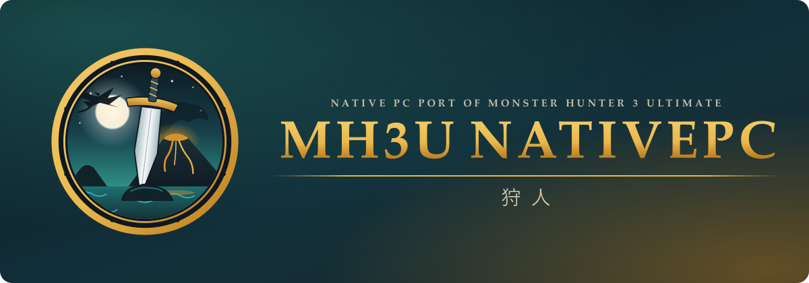
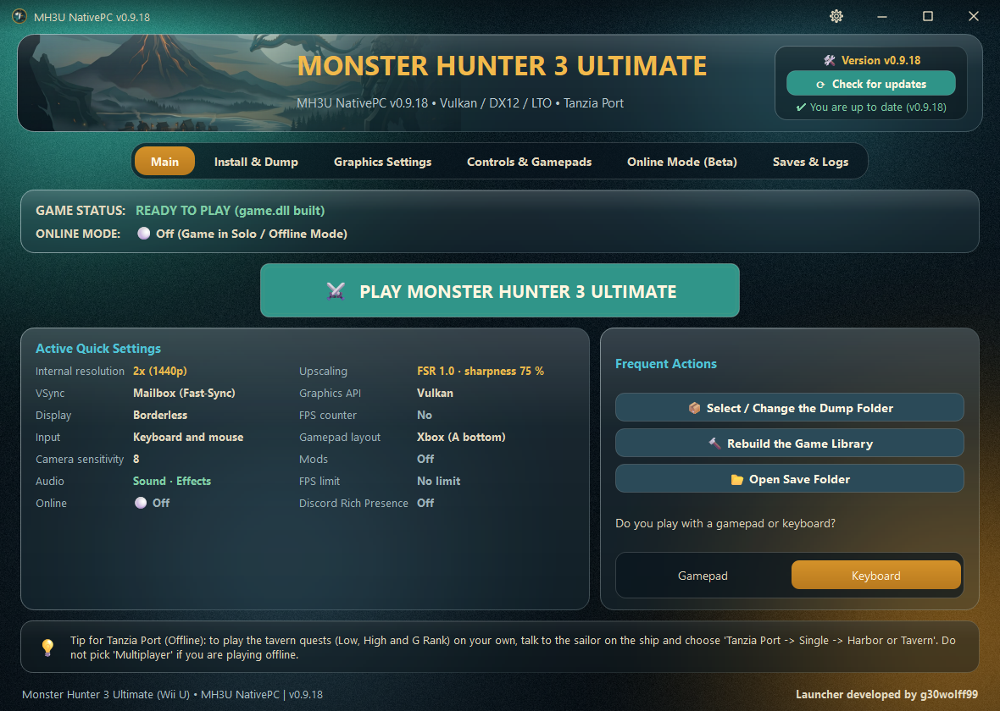
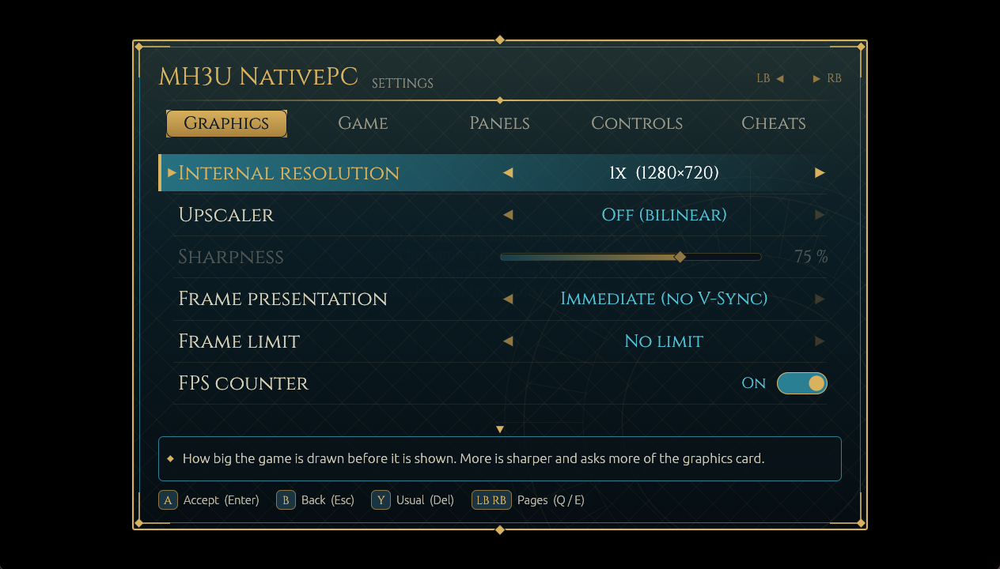
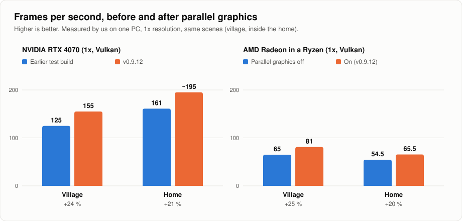
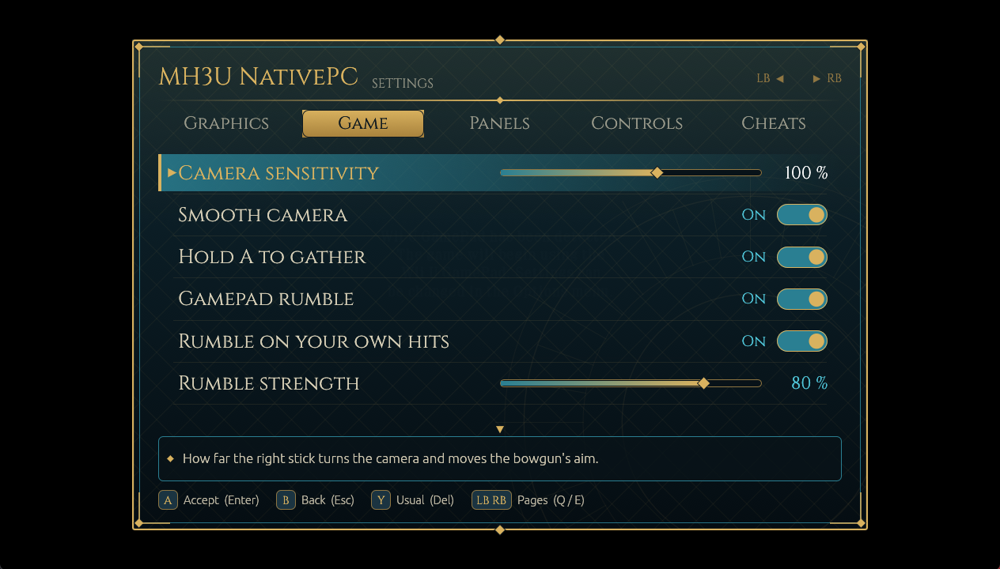
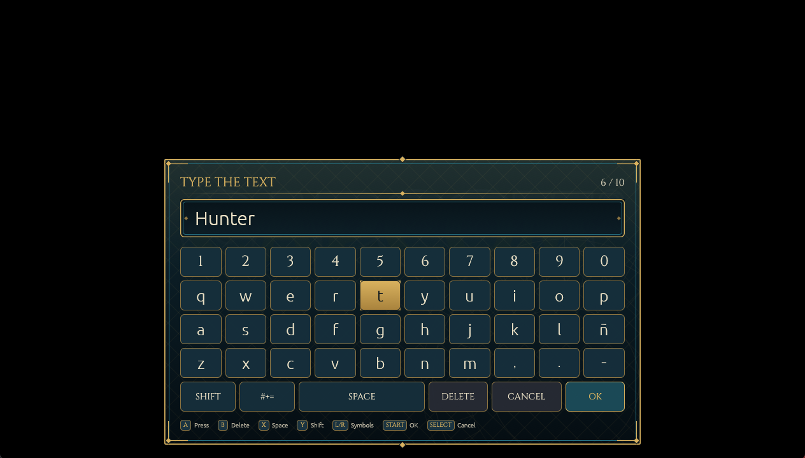
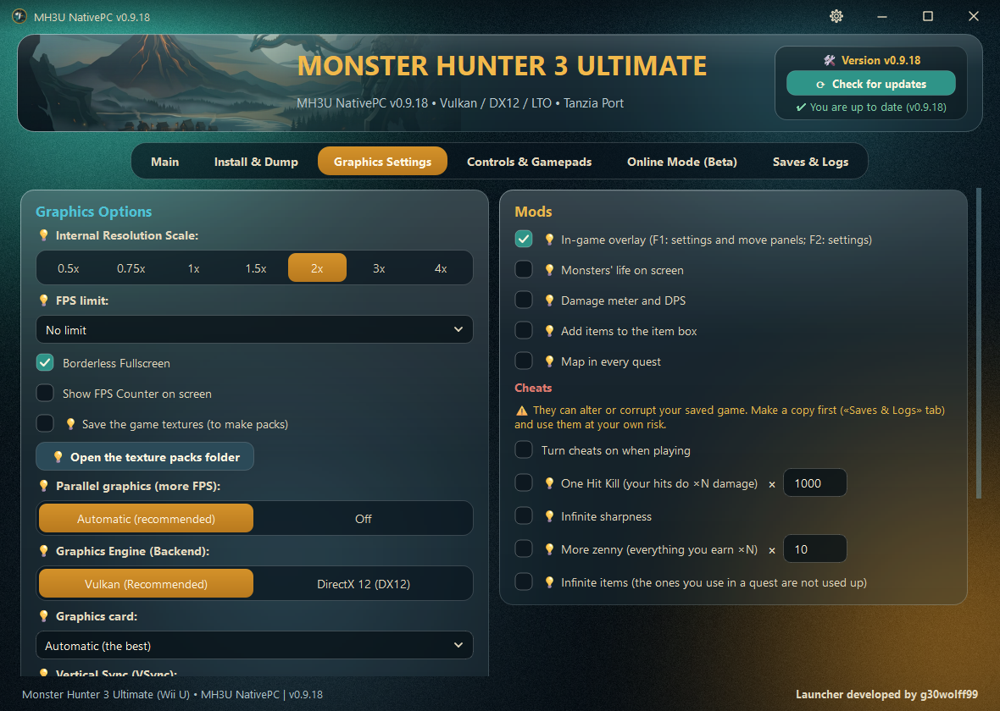
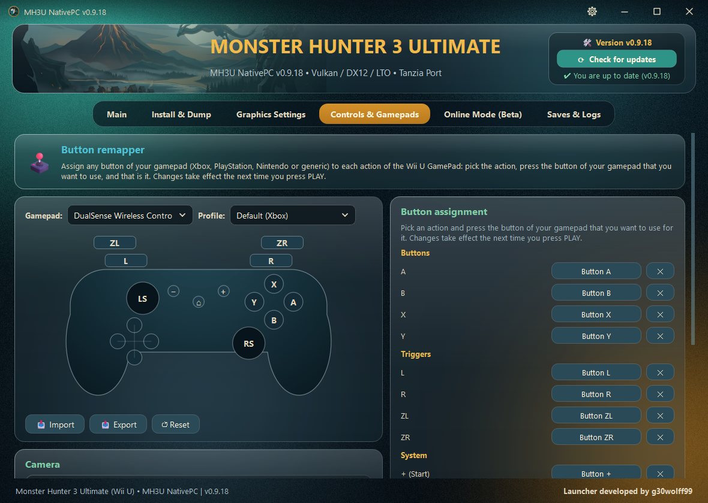
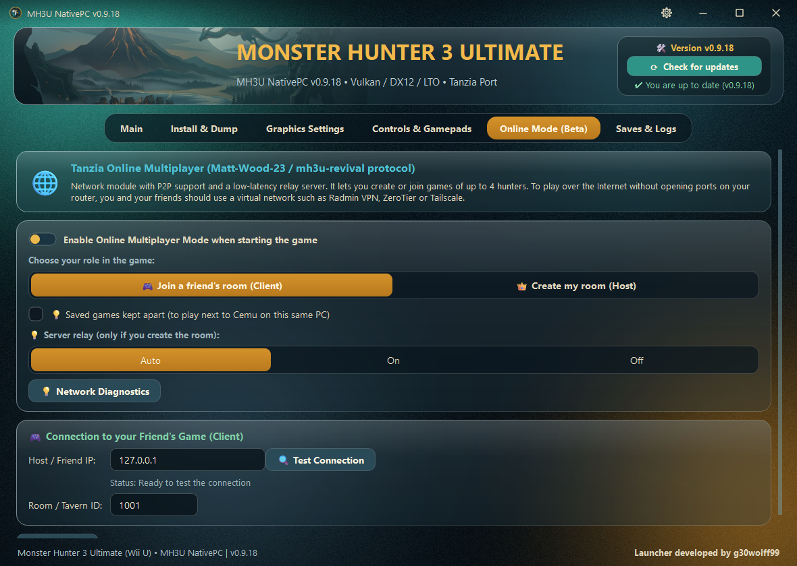

<p align="center">
  
</p>

**An unofficial, enhanced build of the native PC port of *Monster Hunter 3 Ultimate*:** **online play that works**, faster graphics, full controller support (with rumble) and a launcher that sets everything up and keeps itself updated.

[**Download the latest version**](../../releases/latest) · [What changed in each version](CHANGELOG.md) · [Install](#installation)

<p align="center">
  <a href="https://t.me/+-8flfKzcfEZjMWYx"></a>
</p>

<p align="center"><sub>Questions, news, or a bug to report? Write to us on Telegram.</sub></p>

> **Credit where it is due.** MH3U NativePC is built on the work of two people. The **native port itself, the PC recompilation, the translator and the engine** are by **glinesbdev** ([glinesbdev/mh3u-port](https://github.com/glinesbdev/mh3u-port), AGPL-3.0). The **online server and network logic** are by **Matt-Wood-23** ([Matt-Wood-23/mh3u-revival](https://github.com/Matt-Wood-23/mh3u-revival), AGPL-3.0). This project adds improvements on top of them and is not affiliated with, or endorsed by, either of them.

> **Online play works.** As far as we know, this is the only native PC port of *Monster Hunter 3 Ultimate* where online rooms work: you can create a room or join a friend's, hunt with up to 4 players, and even mix with people playing on Cemu. It uses the room server by Matt-Wood-23 and a network layer we built into the port, with automatic firewall rules and a guide to play over Radmin VPN. See the **Online** tab in the picture below.

> **Legal notice.** This repository does not contain or distribute any game file (executables, models, textures, audio). You need your own legitimate copy of *Monster Hunter 3 Ultimate* (Wii U, USA version + update v32) dumped from your console. Fan project, not affiliated with Capcom or Nintendo.





## What is different

Compared with the original port, MH3U NativePC adds:

- **Faster graphics.** The game's drawing work is split across threads, so the frame rate goes up by roughly a fifth to a quarter on the cards we measured (see below). On by default on NVIDIA and AMD cards; there is an *Off* switch in the launcher.
- **No more freezes on AMD cards.** The picture used to freeze, or the game closed, after opening the item box or the equipment screens on some Radeon cards. Fixed.
- **Real AMD FidelityFX Super Resolution 1.0** (EASU + RCAS) or CAS sharpening, a 1x-4x internal resolution and Vulkan or DirectX 12.
- **Controllers, with rumble.** DualSense, DualShock 4 and generic gamepads are read straight from the device, with camera sensitivity, a button remapper and detection of HidHide. The pad **rumbles** when you are hit (harder for bigger hits), when you block, when a monster roars or lands, when you fall, faint, heal or use an item, and with a light tick on your own hits. It works with Xbox pads and, straight over USB or Bluetooth, with the DualSense and the DualShock 4.
- **An on-screen keyboard** for the names and texts the game asks for (your hunter's name, a room's name, a chat line), drawn in the look of the game menu and driven with the gamepad, the mouse or the real keyboard.
- **A menu inside the game** (F1 / F2, or L3 + R3 on a gamepad), made to be driven with the gamepad, the mouse (with its wheel) or the keyboard: resolution from 0.5x to 4x, upscaler, sharpness, present mode, FPS limit and counter, bloom and blur on or off, smooth camera, hold A to gather, gamepad rumble and its strength, the quest map in every quest, camera sensitivity, language, and the monsters' life, parts and damage panels.
- **Mods and cheats, off until you turn them on.** The **Mods** only read the game and draw over it: the life of the monsters (a big bar for the main ones, a thin bar for the small ones) and a damage meter with DPS, which you can drag with the mouse; they are safe and recommended online too. The **Cheats** change the game (One Hit Kill, infinite sharpness, more zenny, infinite items and ammo): they are not blocked, but they can affect your save and, in an online room, the other players' game, so they are not advised there. A separate, optional mod adds **any item to your item box** from a searchable list (it changes your save, so make a copy first).
- **Online rooms.** A room server is built in, with automatic firewall rules (a single UAC prompt) and a guide to play with friends over Radmin VPN. It has been tried with friends and mixed with Cemu players. The log now keeps a short summary of the connection with each player, which helps a lot when something goes wrong online.
- **Fixes to the picture.** Character colours (a cold blue-green tint) and some textures that used the picture of an old frame.
- **A clear message instead of a frozen picture** if the graphics card stops answering, and smaller buffers on cards with little memory.
- **A launcher that does the setup:** finds your dump, downloads a portable Clang on demand, builds the game for your CPU, and updates itself (see [How updates work](#how-updates-work)).

The launcher and the in-game panels (F1 / F2) come in English and Spanish: the language follows Windows (English if it is neither) and can be changed with the gear button in the launcher's title bar.

### Frames per second



Measured by us on a single PC (Ryzen 9600X), at 1x resolution, in the village and inside the home, with the same route each time. On the RTX 4070 the left bars are an earlier test build of the idea, not a published version; on the Radeon built into the Ryzen the only difference between the bars is the *Parallel graphics* switch. Your numbers will depend on your PC; slow processors should gain more, but we have not measured one yet.

### In the game

The menu opens with F1 / F2 (or L3 + R3 on a gamepad) and works with the gamepad, the mouse or the keyboard.

| Game options and rumble | The on-screen keyboard |
|---|---|
|  |  |

### A look at the launcher

| Graphics | Controls | Online |
|---|---|---|
|  |  |  |

## Requirements

- 64-bit Windows 10/11 and a GPU with Vulkan or DirectX 12.
- Your MH3U dump (see [`package/WUA_EXTRACTION_GUIDE.txt`](package/WUA_EXTRACTION_GUIDE.txt) if you have a `.wua`).
- Free disk space for the compiled dump and the portable Clang (~400 MB).

## Installation

1. Download `MH3U_Port_Launcher_vX.Y.Z.zip` from [**Releases**](../../releases/latest) (it contains everything needed: launcher, port engine and online server) and extract it to a writable folder (not `Program Files`).
2. Open `MH3U.exe`, go to **Install & Dump** (*Instalación & Dump* in Spanish), select your game folder and press **Translate and Build Port** (*Traducir y Compilar Port*; first time only).
3. Press **PLAY** (*JUGAR*).

After that, the launcher tells you about new versions by itself.

## How updates work

Every Release publishes a `manifest.json` with the version, the notes and the list of files with their SHA-256. The launcher:

1. Reads `releases/latest/download/manifest.json`.
2. Compares versions and works out which files changed.
3. Downloads only those files to `_update/` and verifies each hash.
4. Closes itself; a temporary script backs up the old files to `_update_backup/`, copies the new ones, **rolls back on error** and reopens the launcher.

It never touches `launcher_config.json`, `game.dll`, `toolchain/` or the logs. If a Release changes the translator output, the launcher asks to rebuild `game.dll` automatically.

## Versions and releases

**Version numbers.** Versions look like `v0.9.10`. They use the `MAJOR.MINOR.PATCH` shape of [Semantic Versioning](https://semver.org/), but while the project is below 1.0 every release raises the last number, whether it brings fixes or new things; the notes of each release say which. Below 1.0 anything may change from one version to the next.

**One release, two files.** Each [Release](../../releases) shows only `MH3U_Port_Launcher_<version>.zip` (everything needed to run) and `manifest.json` (what the launcher reads to update itself). Older releases keep only their zip. The one marked *Latest* is the current version.

**Published versions are never replaced.** If something is wrong, a new version comes out. People who already have the old one would not receive a silent change.

**Where the update files live.** The `updates` branch holds the individual files of every version, with a tag `files-<version>`, so the launcher can download only what changed, pinned to an exact commit. It is not meant to be edited by hand; `main` has everything else.

**Before a release.** The Python tests, a run of the game, and a check that the previous version updates to the new one with the real manifest. The steps for maintainers are in [`docs/RELEASING.md`](docs/RELEASING.md); the history is in [`CHANGELOG.md`](CHANGELOG.md).

## Building from source

```powershell
pip install PySide6-Essentials pillow pyinstaller
cd launcher
python mh3u_launcher_qt.py         # run without packaging
pyinstaller MH3U.spec              # build MH3U.exe
python -m unittest discover -s ../tests
```

The binaries `mh3u-tools.exe` (the port engine) and `server.exe` (NEX server) are not versioned here: they ship in the Releases. Their corresponding source is in [`source-patches/`](source-patches/) (patches on top of `glinesbdev/mh3u-port`) and in the [mh3u-revival v0.2.0-beta](https://github.com/Matt-Wood-23/mh3u-revival/tree/v0.2.0-beta) repository. To publish a new version, see [`docs/RELEASING.md`](docs/RELEASING.md). Version history: [`CHANGELOG.md`](CHANGELOG.md).

## Layout

```
launcher/        Launcher code: core.py (logic), mh3u_launcher_qt.py (window), qt*.py (glass UI), updater.py, PyInstaller spec, assets
package/         Files shipped next to MH3U.exe in the Releases (guides, firewall script, LICENSE, SOURCE, hooks)
source-patches/  Corresponding source of mh3u-tools.exe (AGPL-3.0)
tools/           make_release.py / publish_release.py: build the zip + manifest.json and publish a Release
tests/           Tests (updater, HidHide, toolchain installer, glass UI)
docs/            Release guide
```

## Contact and bug reports

For more information or to report a bug, join the [Telegram channel](https://t.me/+-8flfKzcfEZjMWYx). You can also open an [issue](../../issues). When you report a problem, attach the launcher's log file (`mh3u_latest.log`) if you can.

## Credits

- **Launcher, online integration and the improvements listed above:** g30wolff99 ([@G30vamv](https://github.com/G30vamv)).
- **Native port and PC recompilation:** [glinesbdev/mh3u-port](https://github.com/glinesbdev/mh3u-port) (AGPL-3.0).
- **Server and online network logic:** [Matt-Wood-23/mh3u-revival](https://github.com/Matt-Wood-23/mh3u-revival) (AGPL-3.0).
- Upscaling: [AMD FidelityFX Super Resolution 1.0](https://github.com/GPUOpen-Effects/FidelityFX-FSR) (MIT).
- Portable Clang: [llvm-mingw](https://github.com/mstorsjo/llvm-mingw).
- **Artwork:** the logo and emblem were drawn by g30wolff99 for this project. They are inspired by the look of the logo of [Yakumo](https://github.com/TeamGDB/Yakumo), TeamGDB's native port of *Monster Hunter Portable 3rd*, which he liked so much that he wanted to give MH3U NativePC a crest of its own. Thank you, TeamGDB, for the spark.

## License

The whole project is published under the **GNU AGPL-3.0-only** (see [`LICENSE`](LICENSE)), the same license as `mh3u-port` and `mh3u-revival`, as it is a game preservation project. Releases include `LICENSE.txt` and `SOURCE.txt` with links to the source of each component. The license does not cover the game (© Capcom) nor the Capcom and Nintendo trademarks. Other components: [`THIRD_PARTY.md`](THIRD_PARTY.md).
